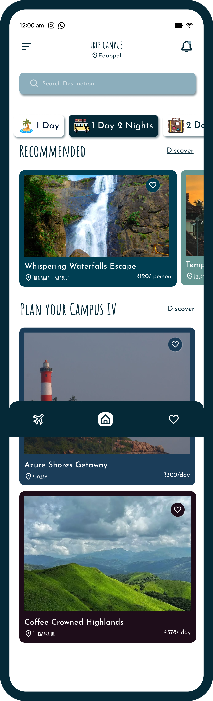
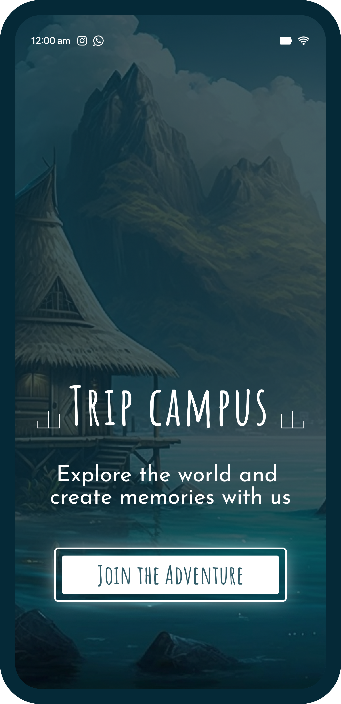

🏝️ Trip Campus

Explore the world and create memories with us. Trip Campus is a Flutter mobile app for discovering and booking short trips, from one-day getaways to multi-night escapes.

Show Image Show Image Show Image

📱 Screenshots
Splash	Home	Trip Details
		
✨ Features

🚀 Welcome screen: a "Join the Adventure" splash that sets the mood.
🔎 Search destinations: find trips by destination.
⏱️ Filter by duration: browse 1 Day, 1 Day 2 Nights, 2 Days and more.
⭐ Recommended trips: curated picks with location and price per person or per day.
❤️ Favorites: save trips you like with a tap.
🖼️ Trip details: photo gallery, overview, duration and reviews.
📅 Book now: go straight from a trip to booking.
🔔 Notifications: bell icon for updates.
🛠️ Tech Stack
Technology	Purpose
Flutter	Cross-platform mobile UI
Dart	Programming language
Add more	e.g. Firebase, GetX, Provider
🚀 Getting Started
Prerequisites
Flutter SDK
Android Studio or VS Code with the Flutter extension
An emulator or a physical device
Run locally
bash
# Clone the repository
git clone https://github.com/sherledge/trip_campus.git
cd trip_campus

# Install dependencies
flutter pub get

# Run the app
flutter run
Build an APK
bash
flutter build apk --release
📂 Project Structure
lib/        # App source code
assets/     # Images, fonts and other static assets
android/    # Android platform code
ios/        # iOS platform code
test/       # Tests
🗺️ Roadmap
 Real trip data and backend
 Working booking and payments
 Reviews from real users
 User accounts
 
👤 Author

Shabeer
